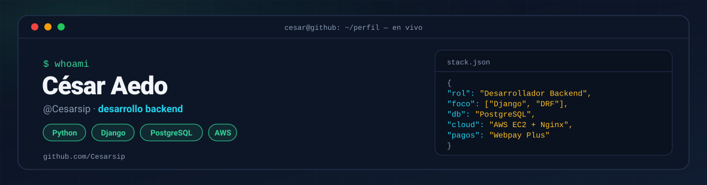
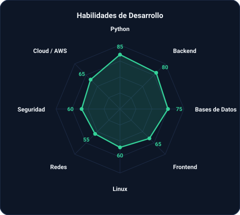
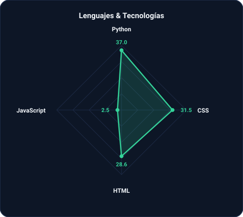
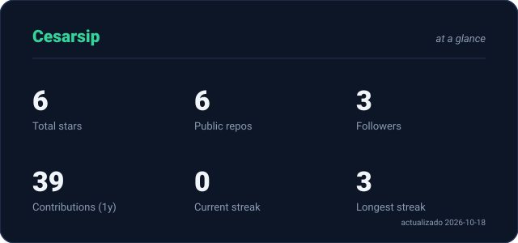
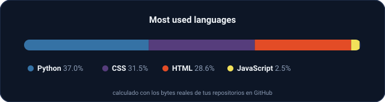

<!-- BANNER PRINCIPAL -->
<picture>
  <source media="(prefers-color-scheme: dark)"  srcset="assets/banner-dark.svg">
  <source media="(prefers-color-scheme: light)" srcset="assets/banner-light.svg">
  
</picture>

 

<!-- NOMBRE / TAGLINE ANIMADO -->

 

<!-- VISITAS AL PERFIL -->

---

## Hola, soy César 👋

Desarrollador backend en formación, construyendo APIs y aplicaciones web con **Python y Django**.

- 💻 **Stack actual:** Python, Django/DRF, PostgreSQL, HTML, CSS, JavaScript
- 🔐 **Enfoque:** APIs REST con JWT, programación segura y procesos transaccionales
- ☁️ **Despliegue:** AWS EC2 · Nginx · Gunicorn · SSL con Let's Encrypt
- 💳 **Proyecto destacado:** [Eva2ProgramacionBackEnd](https://github.com/Cesarsip/Eva2ProgramacionBackEnd) — plataforma de matrículas con carro persistente, bloqueo `select_for_update()` y pago real con **Webpay Plus (Transbank)**
- 🌱 **Aprendiendo:** buenas prácticas de backend, bases de datos y nube
- 💡 **Filosofía:** aprender construyendo

 

## mi stack

---

## señales

<table>
<tr>
<td width="50%" align="center" valign="middle">

<!-- Radar de habilidades (editable en generar_assets.py) -->
<picture>
  <source media="(prefers-color-scheme: dark)"  srcset="assets/radar-skills-dark.svg">
  <source media="(prefers-color-scheme: light)" srcset="assets/radar-skills-light.svg">
  
</picture>

</td>
<td width="50%" align="center" valign="middle">

<!-- Radar de lenguajes (calculado con los bytes reales de mis repos) -->
<picture>
  <source media="(prefers-color-scheme: dark)"  srcset="assets/radar-langs-dark.svg">
  <source media="(prefers-color-scheme: light)" srcset="assets/radar-langs-light.svg">
  
</picture>

</td>
</tr>
</table>

---

## Números matter

<picture>
  <source media="(prefers-color-scheme: dark)"  srcset="assets/card-stats-dark.svg">
  <source media="(prefers-color-scheme: light)" srcset="assets/card-stats-light.svg">
  
</picture>

 

<picture>
  <source media="(prefers-color-scheme: dark)"  srcset="assets/langs-bar-dark.svg">
  <source media="(prefers-color-scheme: light)" srcset="assets/langs-bar-light.svg">
  
</picture>

---

` Build with love · @Cesarsip `

